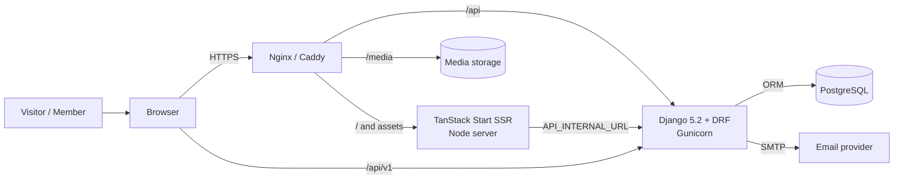
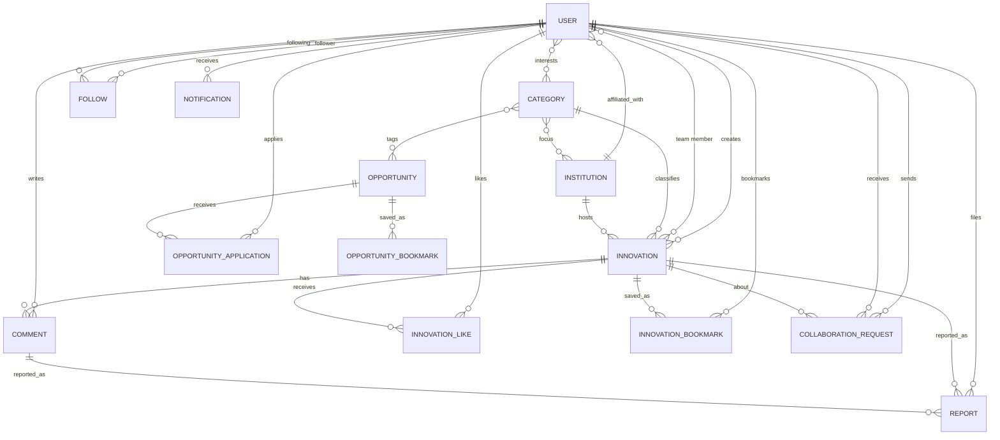

# TIE – Tanzania Innovation Ecosystem

## Technical Project Report

**Audience:** Developers, technical leads, system administrators, QA engineers and future maintainers  
**Date:** November 2026  
**Version:** 1.0.0  
**Related documents:** [`api_documentation.md`](./api_documentation.md), [`testing_report.md`](./testing_report.md), [`setup_and_deployment.md`](./setup_and_deployment.md)

---

## 1. Technical executive summary

The repository was a TanStack Start (React 19) frontend prototype with no server-side persistence. The frontend displayed a fixed catalogue imported from TypeScript modules, used local storage for likes/saves, and presented an authentication page that explicitly stated accounts were not yet available.

The platform was converted into a two-tier application:

- **Frontend:** the existing TanStack Start/React 19 UI, now using React Query and a typed API client. Pages that need SEO (home and detail pages) use server-side loaders; interactive views use client-side queries and mutations.
- **Backend:** a Django 5.2 + Django REST Framework API with session authentication, CSRF protection, role-based staff access, PostgreSQL persistence, image uploads, moderation workflows, notifications, collaboration requests, opportunities and applications.
- **Delivery:** the frontend proxies `/api` and `/media` to Django in development. A same-origin reverse proxy is the recommended production topology.

The implementation preserves the original visual design while replacing all simulated functionality with real API calls and database writes. The backend contains four Django apps (`accounts`, `ecosystem`, `opportunities`, `core`) and 15 domain models plus Django's built-in auth/session models. The migration seed imports the original catalogue without changing URLs or content.

Verification at the time of writing:

- **73 Django/DRF tests passed** against PostgreSQL.
- **27 frontend tests passed**; strict TypeScript, ESLint (0 errors) and production build all pass.
- Real browser journeys passed for registration, publishing, editing, likes, saves, comments, following, collaboration, applications, moderation, opportunity/institution administration, responsive navigation, password-reset UI and innovation image/video upload with gallery/video playback.

---

## 2. Original repository and architecture assessment

### 2.1 Repository structure before changes

```text
src/
  components/site/          site chrome, cards, dialogs, logo, flag
  components/ui/            Radix/shadcn-style UI primitives
  data/catalog.ts           static innovation, innovator, institution and opportunity data
  data/photos.ts            hosted Wikimedia/Lovable photo metadata
  lib/prefs.tsx             language, theme, local likes/saves
  routes/                   home, explore, detail pages, directories, auth, about
  routeTree.gen.ts          generated route tree
  styles.css                tailwind/TIE design tokens
  server.ts, start.ts       TanStack Start server entry and middleware
  test/                     one routing test
public/                     favicon, robots.txt
vite.config.ts              Lovable TanStack config
```

### 2.2 Functional gaps identified

| Frontend element     | Original behaviour                    | Backend need                                                         |
| -------------------- | ------------------------------------- | -------------------------------------------------------------------- |
| Auth page            | “Registration coming soon”            | User model, registration, login, logout, password reset, profile     |
| Catalogues           | Static arrays in `catalog.ts`         | Categories, institutions, innovations, opportunities tables + seed   |
| Search/filter/sort   | Client-side filter over static arrays | Server-side query params, pagination, sorting                        |
| Like/save/follow     | `localStorage` device-only sets       | Persisted likes, bookmarks, follows + auth association               |
| Comments             | Count-only, join prompt               | Comment model, discussion API, notifications                         |
| Collaboration button | Link to auth                          | Collaboration request workflow and dashboard                         |
| Opportunity save     | Local only                            | Opportunity bookmarks                                                |
| Opportunity details  | No apply action                       | Applications and staff review                                        |
| Dashboard            | Not present                           | Owner dashboard + profile/innovation management                      |
| Admin/moderation     | Not present                           | Staff report queue, content moderation, opportunity/institution CRUD |
| Images               | Lovable asset proxy URLs              | Self-hosted public images and uploaded media                         |
| User identity        | None                                  | Public profiles, roles, permission checks                            |

### 2.3 Constraints and decisions

- **Preserve the UI.** Existing pages, components, classes, copy and information architecture were retained. New screens reuse the same tokens and components.
- **Do not rewrite history / Lovable sync.** The work is additive and does not rewrite published commits. Lovable-managed database/migrations were not present; a standalone Django database was added.
- **No fake integrations.** No mobile-money, SMS, AI, government registry or email marketing services were invented. The only external runtime dependencies are optional SMTP and object storage.
- **Seed real existing content.** The static catalogue was migrated as initial published content instead of discarded.
- **Legacy engagement metrics.** The original catalogue contained engagement counts. These are retained as `legacy_likes`, initial views and `base_followers`; live likes/follows are added on top. Comment counts are always live, so the interface never claims comments that do not exist.

---

## 3. Final system architecture

### 3.1 Context diagram



### 3.2 Development flow

```text
Browser
  |
  | http://localhost:8080
  v
Vite dev server (TanStack Start SSR)
  |-- /api/*     -> http://127.0.0.1:8000/api/*
  |-- /media/*   -> http://127.0.0.1:8000/media/*
  |-- SSR loader -> API_INTERNAL_URL (default http://127.0.0.1:8000/api/v1)
  v
Django dev server -> PostgreSQL
```

The Vite proxy is configured in `vite.config.ts` with `API_PROXY_TARGET`. This makes cookies and CSRF same-origin in the browser during development.

### 3.3 Request lifecycle (authenticated mutation)

1. The browser calls `ensureCsrf()` once; Django sets `csrftoken`.
2. `api.post()` reads the `csrftoken` cookie and adds `X-CSRFToken`.
3. The request carries `sessionid` and the CSRF header.
4. Django's session middleware resolves the user; DRF's `CsrfEnforcingSessionAuthentication` enforces CSRF for authenticated requests.
5. The view checks object permissions, validates input and writes through the ORM in a transaction where relevant.
6. Notifications are created synchronously.
7. DRF returns a camelCase JSON response; React Query updates/refetches affected data.

---

## 4. Technology stack and dependencies

### Backend

| Dependency             | Version                | Role                                                   |
| ---------------------- | ---------------------- | ------------------------------------------------------ |
| Python                 | 3.13.12 tested (3.12+) | Runtime                                                |
| Django                 | 5.2.19                 | Web framework, ORM, auth, admin                        |
| djangorestframework    | 3.16.1                 | REST API, serializers, permissions, throttling         |
| django-cors-headers    | 4.9.0                  | Optional cross-origin support                          |
| django-filter          | 25.2                   | Filter integration (query logic is custom in viewsets) |
| drf-spectacular        | 0.28.0                 | OpenAPI schema, Swagger/ReDoc                          |
| Pillow                 | 11.3                   | Image validation/upload                                |
| psycopg                | 3.3.9                  | PostgreSQL driver                                      |
| Python-dotenv          | 1.2.4                  | `.env` loading                                         |
| WhiteNoise             | 6.12                   | Static file serving                                    |
| Gunicorn               | 23.0                   | Production WSGI server                                 |
| pytest / pytest-django | 9.0.3 / 4.14.0         | Automated tests                                        |

### Frontend

| Dependency                         | Version             | Role                                 |
| ---------------------------------- | ------------------- | ------------------------------------ |
| React / React DOM                  | 19.2                | UI                                   |
| TanStack Start / Router            | 1.168.60 / 1.170.41 | SSR and file-based routing           |
| TanStack Query                     | 5.101               | Server-state caching, infinite lists |
| TypeScript                         | 5.8                 | Type safety                          |
| Vite                               | 8.1.5               | Build/dev server                     |
| Tailwind CSS                       | 4.2                 | Styling                              |
| Radix UI / shadcn-style components | current lockfile    | Dialogs, menus, form primitives      |
| Sonner                             | 2.0.7               | Toast notifications                  |
| Vitest / Testing Library           | 4.1 / 16            | Frontend tests                       |

No new runtime frontend dependency was needed. The API layer uses the platform `fetch` and React Query.

---

## 5. Django project structure and modules

```text
backend/
  manage.py
  requirements.txt
  pytest.ini
  .env.example                 # no secrets
  config/
    settings.py                # environment-driven configuration
    settings_test.py           # test overrides
    urls.py                    # admin, API v1, schema, media
    wsgi.py / asgi.py
  accounts/
    models.py                  # User, Follow, Notification
    serializers.py             # auth, profile, public profile, notifications
    views.py                   # session auth, profiles, dashboard
    authentication.py          # session + CSRF enforcement
    urls.py
    admin.py
    migrations/
  ecosystem/
    models.py                  # Category, Institution, Innovation, Like, Bookmark,
                               # Comment, CollaborationRequest, Report
    serializers.py             # camelCase read/write serializers, annotations
    views.py                   # catalog, innovation, comments, collaboration, reports
    filters.py
    management/commands/seed_catalog.py
    migrations/
  opportunities/
    models.py                  # Opportunity, Bookmark, Application
    serializers.py
    views.py
    migrations/
  core/
    constants.py               # regions, stages, types
    pagination.py
    exceptions.py              # consistent API errors, CSRF failure
    permissions.py             # IsStaff, IsOwnerOrStaff, read-only
    utils.py                   # slugs, string lists, links
    views.py                   # health, stats, home aggregate, moderation overview
    urls.py
  tests/
    conftest.py
    test_auth.py               # 17 tests
    test_catalog.py            # 8 tests
    test_innovations.py        # 15 tests
    test_media.py              # 13 tests
    test_opportunities.py      # 6 tests
    test_social.py             # 13 tests
    test_seed.py               # 1 test
  media/
    seed/                      # committed seed images
    uploads/avatars/...        # public runtime uploads (ignored)
  private_media/               # private innovation gallery/video storage (ignored)
```

### Module responsibilities

- **accounts:** identity, sessions, public/private profiles, follows, notifications, owner dashboard.
- **ecosystem:** taxonomy, institutions, innovations, social interactions (likes, bookmarks, comments), collaboration requests, reports/moderation.
- **opportunities:** calls, bookmarks, applications and their review workflow.
- **core:** cross-cutting configuration, error handling, permissions, constants, health, home aggregate, staff overview.

---

## 6. Database architecture, models and relationships

### 6.1 Relationship diagram



### 6.2 Main tables

| Model                    | Key fields and constraints                                                                                                                                                                                                              |
| ------------------------ | --------------------------------------------------------------------------------------------------------------------------------------------------------------------------------------------------------------------------------------- |
| `User` (`accounts_user`) | UUID-free bigint PK, unique email as `USERNAME_FIELD`, unique slug, `full_name`, role enum, avatar, institution FK, skills/looking_for/links JSON, base_followers, `is_public`, staff flags, timestamps                                 |
| `Follow`                 | unique `(follower, following)`; DB constraint prevents self-follow                                                                                                                                                                      |
| `Notification`           | recipient, optional actor, kind, title/message/url, `is_read`; indexed on recipient/read                                                                                                                                                |
| `Category`               | slug primary key, English/Kiswahili name, icon, order                                                                                                                                                                                   |
| `Institution`            | unique slug, name/short name/type/location, description, website, verified, focus M2M, active                                                                                                                                           |
| `Innovation`             | unique slug, content fields, JSON objectives/tech, category FK, stage, cover image, creator FK, team M2M, institution FK, region, status, featured/trending, views, legacy_likes, published_at, generated `search_text`                 |
| `InnovationMedia`        | innovation FK, kind (`image`/`video`), designation (`gallery`/`pitch`/`demo`), private file reference, generated thumbnail/poster, original filename, size, MIME type, order, uploaded_at; DB constraint validates designation per kind |
| `InnovationLike`         | unique `(innovation, user)`                                                                                                                                                                                                             |
| `InnovationBookmark`     | unique `(innovation, user)`                                                                                                                                                                                                             |
| `Comment`                | innovation FK, author FK, body (2,000), hidden flag/reviewer, timestamps                                                                                                                                                                |
| `CollaborationRequest`   | sender/recipient FKs, optional innovation FK, message, status, response, timestamps; self-request constraint; serializer-level duplicate-pending validation                                                                             |
| `Report`                 | reporter, exactly one of innovation/comment, reason/details, status, resolution note, reviewer; DB check constraint                                                                                                                     |
| `Opportunity`            | unique slug, type enum, organizer, deadline, location, summary, eligibility JSON, reward, categories M2M, external URL, status, created_by                                                                                              |
| `OpportunityBookmark`    | unique `(opportunity, user)`                                                                                                                                                                                                            |
| `OpportunityApplication` | unique `(opportunity, applicant)`, motivation, status, review note                                                                                                                                                                      |

### 6.3 Indexes and data integrity

- Indexes on innovation `status/published_at`, category, region, stage; institution type/active; comments by innovation/date; collaboration by sender/recipient status; reports by status/date; media by innovation/kind/order.
- `CheckConstraint` for non-negative views, report target exactly-one, no self-follow, no self-collaboration, and valid media designation for each kind.
- `PROTECT` on category deletion (prevents accidental taxonomy loss); `SET_NULL` for institution affiliations and creators of opportunities (history retained); cascade for user-owned content.
- Slugs are generated with a collision-safe utility (`-2`, `-3`, etc.) and preserved after creation to keep public links stable.

### 6.4 Search strategy

`Innovation.search_text` is regenerated on save from title, tagline, description, region, category and technologies. The API combines it with joins on creator and institution for keyword search. This works identically on SQLite and PostgreSQL without a search extension. For very large catalogues, a PostgreSQL `SearchVector`/GIN index is a future improvement.

---

## 7. Database configuration and migrations

### 7.1 Configuration

`DB_ENGINE=postgres` uses `django.db.backends.postgresql` with environment-driven host/port/name/user/password and persistent connections. `DB_ENGINE=sqlite` is the zero-configuration fallback for quick local work and CI. Tests use a separate test database created by Django.

### 7.2 Migrations

Migrations were generated from models and committed:

```text
accounts/migrations/0001_initial.py
accounts/migrations/0002_initial.py
ecosystem/migrations/0001_initial.py
ecosystem/migrations/0002_innovationmedia.py
opportunities/migrations/0001_initial.py
```

The two-step accounts migration exists because the custom user references the ecosystem institution/category models, creating a circular dependency. Django resolves it with a second migration.

Commands:

```bash
python manage.py migrate
python manage.py makemigrations --check --dry-run   # verification
```

A fresh SQLite migration smoke test and a PostgreSQL migration run both completed successfully.

### 7.3 Private media storage

Gallery images, videos and generated thumbnails/posters use a dedicated `FileSystemStorage` rooted at `PRIVATE_MEDIA_ROOT`. This directory is outside `MEDIA_ROOT` and is never served directly by the web server. The API streams files through `/api/v1/media/{id}/file/` and `/api/v1/media/{id}/thumbnail/`, checking publication status and ownership on every request. Public cover images and avatars continue to use the existing public `MEDIA_ROOT`.

### 7.4 Seed migration

`python manage.py seed_catalog`:

- creates 8 categories, 8 institutions, 6 innovator accounts (unusable passwords), 9 published innovations and 6 opportunities;
- references committed images under `backend/media/seed/`;
- is idempotent; `--update` refreshes seeded fields;
- leaves existing user-created content untouched when not updating;
- does not create likes/comments/follows or fake engagement.

The six seeded innovator accounts exist so the original public profiles and innovations retain real ownership/relations. They cannot be logged into (unusable passwords). A deployment can optionally convert them or leave them as catalogue owners.

---

## 8. Authentication and authorization

### 8.1 User model

`accounts.User` extends `AbstractUser` but removes `username`; email is the unique login identifier. `USERNAME_FIELD = "email"`, `REQUIRED_FIELDS = ["full_name"]`. A custom `UserManager` creates users and superusers with unusable passwords when needed. Emails are normalized to lowercase.

### 8.2 Session auth and CSRF

- Login/register call Django's `login()`, creating a server-side session.
- `sessionid` is HttpOnly and SameSite=Lax by default; `Secure` is enabled in production.
- `csrftoken` is intentionally not HttpOnly because the SPA reads it and sends `X-CSRFToken`.
- `CsrfEnforcingSessionAuthentication` delegates to Django's `CsrfViewMiddleware` logic and converts failures into JSON `403` responses.
- The frontend obtains the cookie through `GET /auth/csrf/` and sends the token on every unsafe request.
- Session lifetime defaults to 14 days.

Why not JWT/localStorage? Session cookies avoid putting long-lived credentials in JavaScript-readable storage and fit the same-origin deployment. For native/mobile clients, a token endpoint can be added later.

### 8.3 Password security

- Passwords use Django's default PBKDF2 hashing and validators (minimum 8, common-password, numeric-only and similarity checks).
- Password reset uses Django's signed token generator; reset links contain base64 user ID + token and expire according to Django's password-reset timeout.
- Reset requests always return the same neutral `202` response to avoid account enumeration.
- No default admin credentials exist. Administrators are created with `createsuperuser`.

### 8.4 Roles and permissions

| Role / flag        | Capabilities                                                                                                               |
| ------------------ | -------------------------------------------------------------------------------------------------------------------------- |
| Anonymous          | Read public published content, search, view profiles/institutions/opportunities, health/stats/home                         |
| Authenticated      | Create/edit own innovation, like, bookmark, comment, follow, collaborate, apply, report, own dashboard                     |
| Owner              | Edit/archive own innovation; delete own comment; edit own profile; accept/decline received requests                        |
| Staff (`is_staff`) | Moderation overview, reports, hide/restore/publish content, opportunity/institution CRUD, application review, Django admin |
| Superuser          | All staff capabilities + Django admin permissions                                                                          |

Important checks are always server-side:

```python
class IsStaff(BasePermission):
    def has_permission(self, request, view):
        return bool(request.user and request.user.is_authenticated and request.user.is_staff)

class IsOwnerOrStaff(BasePermission):
    def has_object_permission(self, request, view, obj):
        return request.user.is_staff or getattr(obj, "creator", None) == request.user
```

Public visibility is enforced in the innovation queryset, not only in the UI:

```python
if user.is_staff:
    pass
elif user.is_authenticated:
    qs = qs.filter(Q(status="published") | Q(creator=user))
else:
    qs = qs.filter(status="published")
```

### 8.5 Profile privacy

Public serializers omit email. The current-user endpoint uses a separate `MeSerializer`, which is the only user response containing an email. Public profiles can also be marked private; anonymous/non-owner access returns 404. This was explicitly tested.

---

## 9. API architecture and endpoint documentation

### 9.1 Architecture

- DRF `ModelViewSet` for innovations, institutions, opportunities.
- `APIView`/`GenericViewSet` for aggregate and workflow endpoints.
- Default permission is `IsAuthenticated`; public endpoints explicitly set `AllowAny` or `IsAuthenticatedOrReadOnly`.
- Standard pagination: 12 items per page, `page_size` up to 50.
- Filtering/search is implemented with explicit querysets and `comma_values()` for repeatable filters.
- Serializers expose camelCase keys to match the existing frontend; write serializers validate and clean input.
- A custom exception handler normalizes DRF and Django errors into `{error: {code, message, fields}}`.
- Throttling: anonymous 120/min, user 600/min, auth 15/min.
- Uploads are size-limited by serializer validation and Pillow validation.

### 9.2 Endpoint groups

| Group            | Representative endpoints                                                             | Auth                                    |
| ---------------- | ------------------------------------------------------------------------------------ | --------------------------------------- |
| Session/auth     | `POST /auth/register/`, `/login/`, `/logout/`, `GET/PATCH /auth/me/`, password reset | Public / session                        |
| Profiles         | `GET /auth/innovators/`, `/auth/users/{slug}/`, follow/unfollow                      | Public / session                        |
| Dashboard        | `GET /auth/dashboard/`, notifications                                                | Session                                 |
| Catalogue        | `GET /categories/`, `/institutions/`, `/innovations/`                                | Public                                  |
| Innovation write | `POST/PATCH/DELETE /innovations/...`, like/bookmark/moderate                         | Session / owner / staff                 |
| Innovation media | `/media/{id}/file/`, `/media/{id}/thumbnail/`, media fields on innovation write      | Published public / draft owner or staff |
| Discussion       | comments, collaboration requests, reports                                            | Public read / session write             |
| Opportunities    | list/detail, bookmark, apply, staff CRUD, applications                               | Public / session / staff                |
| Core             | `/health/`, `/stats/`, `/home/`, `/moderation/overview/`                             | Public / staff                          |
| Docs             | `/api/schema/`, `/api/docs/`, `/api/redoc/`                                          | Public                                  |

The complete endpoint reference, request bodies, filters and response examples are in [`docs/api_documentation.md`](./api_documentation.md). Swagger UI is served at `/api/docs/`.

### 9.3 Serializer example

```python
class InnovationReadSerializer(serializers.ModelSerializer):
    category = serializers.CharField(source="category_id", read_only=True)
    creator = UserSummarySerializer(read_only=True)
    institution = serializers.SerializerMethodField()
    image = serializers.SerializerMethodField()
    likes = serializers.SerializerMethodField()
    comments = serializers.SerializerMethodField()
    publishedAt = serializers.DateTimeField(source="published_at", read_only=True)
    viewer = serializers.SerializerMethodField()

    def get_likes(self, obj):
        live = getattr(obj, "live_likes", None)
        if live is None:
            live = obj.likes.count()
        return obj.legacy_likes + live
```

List queries use `Count` annotations and `Exists` annotations for viewer flags (`viewer_liked`, `viewer_saved`) to avoid N+1 queries for common lists.

---

## 10. Frontend–backend integration

### 10.1 API client

`src/lib/api.ts` resolves the base URL differently for server and browser:

- Browser: `VITE_API_URL` or same-origin `/api/v1`.
- Server-side rendering: `API_INTERNAL_URL` or `http://127.0.0.1:8000/api/v1`.

It provides `api.get/post/patch/delete`, query-string serialization, credentials, CSRF token handling, JSON/multipart support, typed `ApiError`, and network-failure normalization.

### 10.2 Authentication state

`AuthProvider` (`src/lib/auth.tsx`) queries `/auth/me/` through React Query, treats 401/403 as signed-out, and exposes login/register/logout/refresh/setUser. Login/register set the cache from the response and invalidate data queries so viewer-specific states refresh. Logout clears the query cache.

### 10.3 Data fetching

`src/lib/queries.ts` defines query keys and hooks:

- `useHome` with SSR loader data as initial data.
- `useInfiniteInnovations`, `useInfiniteInnovators`, `useInfiniteInstitutions`, `useInfiniteOpportunities` with "Load more".
- `useInnovation`, `useInnovator`, comments, dashboard, notifications, bookmarks, requests, applications, moderation.

The home and detail routes use TanStack Router loaders for SSR metadata and initial data. Detail loaders request `?track=0` to avoid double-counting views when the client refetches authenticated viewer state.

### 10.4 Mutations and UI feedback

- API mutations use React Query invalidation for affected domains (home, list, detail, bookmarks, dashboard, moderation).
- Forms show field-level validation from `ApiError.fields`; global errors are displayed in styled banners.
- Like/save actions are optimistic with rollback on failure.
- Guests are prompted to log in when attempting protected actions.
- Toasts confirm saves, applications, comments, profile changes, moderation actions and errors.
- Every list has skeleton/loading, empty and error states.
- Dashboard and moderation routes are guarded client-side and enforced server-side.

### 10.5 Preserved UI

Existing page layouts, typography, colors, navigation, footer, cards, carousel, bilingual labels and dark mode were retained. New dashboard/moderation screens reuse the existing buttons, cards, badges, dialogs and spacing tokens. The auth page was converted from an informational placeholder into working forms while keeping the same two-column photographic design.

---

## 11. Business logic implementation

### 11.1 Innovation lifecycle

- `draft`: visible only to the owner/staff.
- `published`: public; appears in search/home and increments views on detail.
- `hidden`: moderator action; not public; owner can still see it.
- `archived`: owner deletion or staff action; hidden from public lists.
- New content publishes immediately by default (`AUTO_PUBLISH_INNOVATIONS`) to match the open platform design; staff can hide it after reports.
- Owners can save as draft, publish, edit and archive. Team members are resolved by existing account emails; unknown emails return a validation error.

### 11.2 Engagement

- Likes/bookmarks are unique per user+innovation and toggle.
- Public like counts combine imported `legacy_likes` with live likes. Comments are always live.
- Follows are unique, prevent self-follow, and increase the public follower count above the imported baseline.
- Follows and likes generate notifications where appropriate (comments, follows, collaboration).
- View counts are incremented only for published innovation detail requests and can be suppressed by `track=0` for SSR.

### 11.3 Collaboration workflow

```text
sender creates (pending)
   ├─ recipient accepts -> accepted + notification to sender
   ├─ recipient declines -> declined + notification to sender
   └─ sender withdraws -> withdrawn
```

- Requests can target an innovation (recipient is its creator) or a profile.
- Duplicate pending requests are rejected.
- Only pending requests can be answered.
- Messages are length-limited and displayed as plain text (React escapes them).

### 11.4 Reports and moderation

- A user can report an innovation or one comment, with a reason and optional details.
- Exactly one target is enforced at both serializer and database level.
- One open report per reporter/target is allowed.
- Staff can resolve (which hides the target) or dismiss.
- Hiding a target notifies its creator; resolving/dismissing notifies the reporter.
- The moderator workspace shows open reports, hidden/draft content, recent applications, opportunities and institutions.
- Django admin remains available for full data operations.

### 11.5 Opportunities and applications

- Staff create opportunities with type, deadline, eligibility, reward, categories and publication status.
- `isOpen` is computed from published status and deadline.
- One application per user/opportunity; motivation must be at least 20 characters; closed opportunities reject applications.
- Staff can move applications to under review, accepted or rejected; the applicant receives a notification and dashboard status.
- Bookmarks are unique and persisted.

### 11.6 Innovation media lifecycle

- A maximum of four gallery images and two videos are allowed per innovation, counting existing media not explicitly removed.
- Images are validated with Pillow; JPEG, PNG and WebP are accepted. Videos must have an MP4/WebM extension, an accepted MIME type and valid container magic bytes.
- New gallery images and videos are stored privately with generated metadata (`original_filename`, `file_size`, `mime_type`, `order`). Images get a 900×900 JPEG thumbnail; videos get a browser-generated poster resized server-side.
- Exactly one video is marked `pitch`; the other is `demo`. The form can change the primary video, and the backend re-designates the rest.
- Removing or replacing media deletes the old private file and thumbnail via a `post_delete` signal. QuerySet deletions and cascading innovation deletion both trigger cleanup.
- Public detail responses include media metadata; catalogue cards use a thumbnail-only `previewImage` when no cover exists. Public video players use `preload="none"` with posters, so video bytes are fetched only when the user presses play.
- Draft/hidden/archived media endpoints return 404 to anonymous users and non-owners.

### 11.7 Notifications

Notifications are created synchronously for:

- new comments on your innovation;
- new followers;
- new collaboration requests and responses;
- opportunity application decisions;
- moderation hiding actions;
- report resolutions for the reporter.

They appear in the dashboard and notification center, support mark-one/mark-all-read, and link to relevant pages.

---

## 12. Security measures and configurations

| Area                     | Implementation                                                                                                 |
| ------------------------ | -------------------------------------------------------------------------------------------------------------- |
| Password storage         | Django PBKDF2 hashing; validators; no plaintext storage                                                        |
| Session                  | Server-side sessions, HttpOnly cookie, SameSite=Lax, Secure in production, 14-day age                          |
| CSRF                     | CSRF cookie + `X-CSRFToken` required for authenticated unsafe requests; custom JSON failure                    |
| Authorization            | Deny-by-default permissions; object ownership checks; staff checks for moderation/admin tools                  |
| Public/private data      | Email omitted from public serializers; private profiles return 404 to outsiders                                |
| Input validation         | DRF serializers, field length/choice validation, URL validation, list cleaning, image type/size validation     |
| SQL injection            | Django ORM/parameterization; no raw user SQL                                                                   |
| XSS                      | React escapes content; no `dangerouslySetInnerHTML` for user data                                              |
| Uploads                  | Pillow/ImageField for images; MP4/WebM extension/MIME/magic checks for video; configurable size limits         |
| Private media            | Gallery/video files outside public media root; every read checks publication/ownership; Range support; nosniff |
| Rate limiting            | DRF throttles; per-scope auth limit; shared cache recommended for scale                                        |
| Error responses          | No stack traces/secrets to clients; server errors logged; generic 500 payload                                  |
| Transport                | HTTPS/secure-cookie/HSTS settings; `SECURE_PROXY_SSL_HEADER` for reverse proxy                                 |
| Headers                  | `X-Content-Type-Options: nosniff`, `X-Frame-Options: DENY`, referrer policy                                    |
| Secrets                  | `.env` ignored; `.env.example` contains placeholders only; no production credentials in repo                   |
| CORS                     | Explicit allow-list and credentials; same-origin recommended                                                   |
| Enumeration              | Password reset returns a generic 202; login error is generic                                                   |
| Duplicate/abuse controls | Unique constraints for likes/bookmarks/follows/applications; duplicate pending collaborations rejected         |
| Admin                    | Django admin staff-only; moderation API staff-only                                                             |

No system is "fully secure" by assertion; production should add a shared cache, HTTPS, dependency updates, backups and an external security review.

---

## 13. Environment variables and configuration

See [`setup_and_deployment.md`](./setup_and_deployment.md) for the complete table. Key groups:

- Django: `DJANGO_SECRET_KEY`, `DJANGO_DEBUG`, hosts, CSRF trusted origins, timezone.
- Database: `DB_ENGINE`, `DB_NAME`, `DB_USER`, `DB_PASSWORD`, `DB_HOST`, `DB_PORT`.
- Frontend URL: `FRONTEND_URL` (password-reset links); `API_PUBLIC_URL` for absolute media URLs when SSR runs through an internal API host.
- Email: `EMAIL_BACKEND`, SMTP host/port/user/password/TLS/from address.
- Security: secure cookies, SSL redirect, HSTS.
- Limits: cover/avatar sizes, gallery image count/size, video count/size, video poster size; private media root.
- Frontend media accept rules and client-side count/size validation are mirrored in `src/lib/media.ts`.
- Frontend: `VITE_API_URL` (browser), `API_INTERNAL_URL` (SSR), `API_PROXY_TARGET` (dev proxy).

No secret values are included in this report or committed to the repository.

---

## 14. Testing methodology and coverage

### Backend

- pytest + pytest-django, `config.settings_test`.
- Real PostgreSQL test database (also SQLite compatible).
- DRF `APIClient` with both `force_authenticate` and real session/CSRF clients.
- Tests assert HTTP status, response shape, database side effects, notifications, constraints and permission denials.
- Seed command tested twice for idempotency.

### Frontend

- Vitest + jsdom.
- Route matching for every page, including guarded dashboard/moderation routes without executing loaders.
- API client tests with mocked `fetch` for URL construction, credentials, CSRF header, error normalization, network failure and CSRF concurrency.

### End-to-end

- Playwright with real Chromium against both running servers.
- Real cookies, CSRF token rotation and PostgreSQL writes.
- Two-user collaboration flow and staff moderation flow.
- Responsive mobile viewport and navigation.

Full results and defect history: [`testing_report.md`](./testing_report.md).

---

## 15. Detailed test results

| Area                                  | Result                                                                             |
| ------------------------------------- | ---------------------------------------------------------------------------------- |
| Backend suite                         | **73 passed / 0 failed**                                                           |
| Frontend unit suite                   | **27 passed / 0 failed**                                                           |
| TypeScript                            | **0 errors**                                                                       |
| ESLint                                | **0 errors**, 9 existing Fast Refresh warnings                                     |
| Production build                      | **Success**                                                                        |
| Node SSR production build smoke test  | **Success** (HTML + static assets served)                                          |
| PostgreSQL migrations                 | **Success**                                                                        |
| SQLite migration smoke test           | **Success**                                                                        |
| Django system check                   | **No issues**                                                                      |
| Migration drift check                 | **No changes detected**                                                            |
| Seed idempotency                      | **Second run created 0 duplicates**                                                |
| Health endpoint                       | **200, database OK**                                                               |
| E2E user journey A (publish/engage)   | **Passed**                                                                         |
| E2E user journey B (collaboration)    | **Passed**                                                                         |
| E2E user journey C (moderation/admin) | **Passed**                                                                         |
| E2E discovery/filter/mobile/reset     | **Passed**                                                                         |
| E2E media upload/gallery/playback     | **Passed** (4 images, 2 videos, limits, draft privacy, no pre-play video download) |
| Real SMTP inbox delivery              | **Not tested** (no SMTP credentials)                                               |
| Load/performance testing              | **Not tested**                                                                     |
| External penetration test             | **Not performed**                                                                  |
| Full WCAG audit                       | **Not performed**                                                                  |

---

## 16. Bugs identified and resolved

| Bug                                        | Technical cause                                  | Fix                                                   | Verification                          |
| ------------------------------------------ | ------------------------------------------------ | ----------------------------------------------------- | ------------------------------------- |
| No persistence for catalogues              | Static arrays                                    | DB models, seed, API                                  | Category/innovation tests; E2E        |
| No working accounts                        | Placeholder UI                                   | User model, session auth, auth views/forms            | 16 auth tests; E2E registration/login |
| Local-only likes/saves/follows             | localStorage                                     | Persisted models + React Query                        | Social tests; E2E                     |
| Email leaked in public innovator directory | Reused private serializer                        | Public serializer without email + `MeSerializer`      | Privacy test asserts no email         |
| 500 on innovation annotations              | `Innovation.likes.through` on a reverse FK       | Explicit `InnovationLike`/`InnovationBookmark` models | All innovation tests                  |
| Institution filter 500                     | Filtered FK by slug using `institution_id`       | `institution__slug__in`                               | Explore filter test                   |
| `Http404` broke exception handler          | Assumed `.detail` on every exception             | Explicit Django exception branches                    | NotFound tests                        |
| Notification 500                           | Missing camelCase field declarations             | `isRead`, `createdAt` declared                        | Notification test                     |
| Admin new-institution crash                | Null dereference in dialog initial state         | Branch-specific default                               | E2E create institution                |
| Dashboard redirect loop to `/auth`         | Redirect effect re-ran with new pathname         | Only redirect while path starts with `/dashboard`     | E2E guard test                        |
| Local images 404                           | Hosted Lovable asset proxy unavailable locally   | Downloaded licensed assets to `public/images`         | Browser asset check                   |
| Seed dictionary mutation                   | In-place `pop()`                                 | Copy records per loop                                 | Seed idempotency test                 |
| Unpublished content exposure               | Would be possible if filtering only in UI        | Server queryset rules + tests                         | Draft/hidden 404 tests                |
| Duplicate applications/likes/etc.          | Possible without constraints                     | Unique constraints and serializer checks              | Constraint tests                      |
| Stale media list after edit                | Prefetched media cache survived update           | Clear prefetch cache after media mutations            | Media update tests                    |
| Draft media URL could be guessed           | Files under public media root would be fetchable | Private storage + permission-checked streaming        | Draft media access tests              |
| Orphaned media objects after removal       | FileField does not delete automatically          | `post_delete` signal removes file + thumbnail/poster  | Media cleanup tests                   |

---

## 17. Known issues and technical debt

1. **OpenAPI completeness.** Swagger/ReDoc are available, but some aggregate `APIView` endpoints and serializer method fields are represented as generic objects/strings because they lack explicit spectacular annotations. The hand-written API documentation is authoritative. Adding `@extend_schema` annotations is a low-risk improvement.
2. **Rate-limit cache.** DRF throttling uses Django's default local-memory cache. Multiple Gunicorn workers each keep separate counters; configure Redis/Memcached for consistent limits.
3. **Email delivery.** Development uses the console backend. Real password-reset delivery needs SMTP credentials, DNS/SPF/DKIM and failure monitoring.
4. **Media storage.** Local filesystem storage is the default. Multi-instance deployment needs S3-compatible storage or a shared volume.
5. **Notifications are synchronous.** Creating a notification is part of the request. For high volume, move notifications/email to a background worker (Celery/RQ) and add retries.
6. **No email verification or two-factor authentication.** Accounts are usable immediately after registration. Add email verification and optional 2FA before a large public launch if policy requires it.
7. **No granular moderator roles.** `is_staff` grants the staff workspace. If moderators need limited scopes (only reports, only opportunities), add Django groups/permissions and map them in API permissions.
8. **No audit trail beyond Django admin log and report fields.** Sensitive moderation decisions could benefit from an append-only audit model.
9. **No full-text search engine.** `search_text` LIKE queries are adequate for the current catalogue; at large scale, use PostgreSQL full-text/trigram indexes or a search service.
10. **No CI pipeline committed.** Commands are documented and all checks pass locally. Add GitHub Actions (PostgreSQL service, pytest, Vitest, tsc, build) and staging deployment.
11. **Legacy engagement values.** Imported baseline likes/views/followers are retained for continuity. They are clearly separated in the model but displayed together with live values by design.
12. **Public content moderation policy.** Publishing is immediate; policy/terms and moderation service-level targets must be defined by the platform owner.
13. **No native mobile apps/tokens.** The API is session-based. Add a token authentication scheme if official mobile clients are required.
14. **Large uploads use the application server.** Four images and two videos are submitted in one multipart request; Nginx must allow the configured body size (160 MB in the example). For high traffic, add direct-to-object-storage uploads or per-file upload endpoints.
15. **Uploaded public images are stored as uploaded; gallery images get thumbnails but no AV scanning.** Add malware scanning and an image pipeline/CDN for production.
16. **No server-side video transcoding.** The platform accepts MP4/WebM and relies on browser codec support. Add background transcoding and adaptive streaming for broader device compatibility at scale.
17. **No in-browser camera recording yet.** The upload flow is designed for existing device files; recording is a future extension.

---

## 18. Deployment requirements and instructions

### Minimum requirements

- Python 3.12+
- PostgreSQL 15+ (recommended) or SQLite for a demo
- Node.js 20+/Bun for the frontend build
- Reverse proxy with TLS
- Persistent media storage
- SMTP provider for password reset
- 2 GB RAM / 2 vCPU for a small pilot; scale with traffic

### Deployment sequence

1. Provision PostgreSQL and a database/user.
2. Configure backend `.env` with `DJANGO_DEBUG=false`, strong secret, allowed hosts, CSRF trusted origins and secure cookies.
3. Install requirements, migrate, seed, collectstatic, create superuser.
4. Start Gunicorn behind Nginx; proxy `/api` and `/media`.
5. Build the frontend (`NITRO_PRESET=node-server`) with `VITE_API_URL=/api/v1` and `API_INTERNAL_URL=http://127.0.0.1:8000/api/v1`; start the Node server on port 3000.
6. Proxy `/` to the frontend; preserve `Host` and `X-Forwarded-Proto`.
7. Verify `/api/v1/health/`, registration, login, publishing, an image upload and a password reset with real SMTP.
8. Run the documented test suite against staging before release.

A complete guide with Nginx, Gunicorn, security settings and environment tables is in [`setup_and_deployment.md`](./setup_and_deployment.md).

---

## 19. Backup, maintenance and operational recommendations

### Backups

- Daily `pg_dump --format=custom`; keep at least 30 daily + monthly archives.
- Back up media together with the database; a DB restore without matching media produces broken images.
- Test restore quarterly, including Django migrations and media paths.

### Monitoring

- Health endpoint `/api/v1/health/` checks DB connectivity.
- Monitor 5xx rate, latency, database connections, disk, memory, upload errors and email failures.
- Centralize Django/Gunicorn logs; retain at least 30 days.
- Add uptime checks for the home page, API health and auth endpoints.

### Maintenance

- Apply Django and dependency security updates monthly; review release notes for breaking changes.
- Rotate `DJANGO_SECRET_KEY` carefully (invalidates sessions/password-reset tokens).
- Keep `DEBUG=false`; never expose `.env` or media directory listings.
- Audit staff accounts quarterly; revoke access when roles change.
- Review reports and moderation decisions according to platform policy.
- Run `makemigrations --check` in CI to catch model/migration drift.
- For multi-worker deployments, configure a shared cache and a shared media backend before scaling horizontally.

### Incident response

- Preserve logs and database snapshots before remediation.
- Disable a compromised staff account (`is_active=false`) and rotate secrets.
- Invalidate sessions by rotating the secret key or clearing sessions if required.
- Restore from backup only after identifying the cause and patching it.

---

## 20. Future technical improvements

1. Add CI/CD with PostgreSQL, tests, lint, typecheck, build and deployment gates.
2. Annotate all API views with drf-spectacular for a fully typed OpenAPI schema and generated clients.
3. Move notifications/email to Celery/RQ with retries and dead-letter handling.
4. Add Redis cache for throttling and hot home/list responses.
5. Move media to S3-compatible storage with image resizing/optimization and CDN delivery.
6. Add email verification, optional 2FA and account recovery policies.
7. Add granular moderator permissions and an append-only moderation audit log.
8. Add PostgreSQL full-text search/trigram indexes and faceted counts for large catalogues.
9. Add API token authentication for native mobile clients and third-party integrations.
10. Add application/innovation analytics dashboards for owners and programme managers.
11. Add automated accessibility tests (axe) and performance budgets/Lighthouse checks.
12. Add Docker/Compose or infrastructure-as-code for reproducible staging/production environments.
13. Add rate limiting and anti-spam controls for comments/reports (e.g., per-user action quotas).
14. Add localized backend content fields or translation workflow if user content must be bilingual.
15. Add direct-to-object-storage multipart uploads and background video transcoding for large-scale media.
16. Add an in-platform camera recorder using the existing media API once device-recording support is prioritised.

---

## Appendix A – Key implementation files

| Concern               | File                                                                            |
| --------------------- | ------------------------------------------------------------------------------- |
| Settings              | `backend/config/settings.py`                                                    |
| URL routing           | `backend/config/urls.py`                                                        |
| User/auth             | `backend/accounts/models.py`, `serializers.py`, `views.py`, `authentication.py` |
| Innovations/social    | `backend/ecosystem/models.py`, `serializers.py`, `views.py`                     |
| Opportunities         | `backend/opportunities/models.py`, `serializers.py`, `views.py`                 |
| Core aggregate/health | `backend/core/views.py`, `exceptions.py`, `permissions.py`                      |
| Seed                  | `backend/ecosystem/management/commands/seed_catalog.py`                         |
| Tests                 | `backend/tests/`                                                                |
| API client            | `src/lib/api.ts`                                                                |
| Auth provider         | `src/lib/auth.tsx`                                                              |
| Queries/hooks         | `src/lib/queries.ts`                                                            |
| API types             | `src/lib/api-types.ts`                                                          |
| Public pages          | `src/routes/`                                                                   |
| Dashboard             | `src/routes/dashboard.*`, `src/components/dashboard/`                           |
| Moderation            | `src/routes/moderation.tsx`, `src/components/dashboard/AdminDialogs.tsx`        |
| Development proxy     | `vite.config.ts`                                                                |

## Appendix B – Role of the imported baseline metrics

Innovations store `legacy_likes`; users store `base_followers`; innovations store initial `views`. These fields preserve the engagement that existed in the original catalogue. Live likes/follows are counted separately and added at serialization time. No baseline comments are fabricated: `comments` is always the live visible-comment count, and the discussion area shows the actual records.

## Appendix C – Commands

```bash
# Backend
cd backend
python manage.py check
python manage.py migrate
python manage.py seed_catalog
python manage.py createsuperuser
python manage.py runserver 127.0.0.1:8000
pytest

# Frontend
bun install --frozen-lockfile
bun run dev --host 127.0.0.1 --port 8080
bun run test
bunx tsc --noEmit
bun run lint
bun run build
```

## Appendix D – Evidence and reproducibility

The QA environment used PostgreSQL 18, Python 3.13.12, Django 5.2.19, Node 22.20.0, Bun 1.4.4 and system Chromium. All test commands, results and the complete E2E scenario list are recorded in [`testing_report.md`](./testing_report.md). The source repository contains the migrations, seed command, tests and documentation needed to reproduce the result from an empty database.
